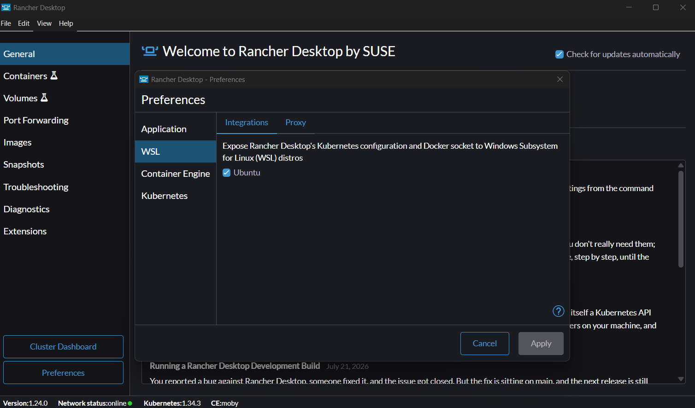

# Common tools/softwares

For this project, we strive to use same/similar tools/softwares for each developer to facilitate smooth and ergonomic shared developer practices. Below is a list of common softwares used in this project

- Windows Subsystem for Linux (WSL2) (Windows users only)
- Node Version Manager (NVM)
- SDKMan (managing SDKs for the Java Virtual Machine)
- IntelliJ or Visual Studio Code (VSCode) (code editors)
- OpenAI ChatGPT and Codex (AI tools)
- Rancher Desktop (GUI for Docker) or Docker Engine in WSL2

**We do not want to force anyone to use these softwares!** However, **it is highly recommend** to install and use these softwares if they fulfill a need of yours. Installation steps and the reasoning for the choice of software in their respective use case is explained under the subheading for each software separately.

If you have opinions on other softwares that you strongly want to use that conflict with any listed here, you are encouraged to discuss it with your team leader!

## Windows Subsystem for Linux (WSL2) (Windows users only)

If you are using a Windows machine, **it is highly recommended to use [WSL2](https://learn.microsoft.com/en-us/windows/wsl/about).** WSL2 allows you to run a Linux environment on your Windows machine without the need for a separate virtual machine or dual booting.

### Reasoning

The reasoning for why we **strongly recommend using WSL2** are the following:

- Linux is Unix-based, while Windows is not. Every script that has been written throughout the many years at OPH have been written in Bash, which is supported by Unix-based systems. **Scripts written in Bash cannot be run directly on Windows systems**, hence it would require us to rewrite them all to support e.g. Powershell.
- Other developers in this project use MacOS, which is also Unix-based. If the Windows users use WSL2, interoperability between Windows and MacOS developers is significantly better.
- Getting comfortable and efficient with using Unix-based systems is an important skill for a developer, as the vast majority of servers run on Linux. All of the servers in this project are run using Linux.

### Installation

To install WSL2, go to [this page](https://learn.microsoft.com/en-us/windows/wsl/install) and follow the instructions. We recommend installing the default Ubuntu distribution.

As for the terminal, we recommend to use the [Windows Terminal](https://learn.microsoft.com/en-us/windows/terminal/install) application.

## Node Version Manager (NVM)

For handling different Node versions, we utilize [NVM](https://www.nvmnode.com/).

### Reasoning

The reasoning for using NVM is:

- Well supported and used Node version manager
- Several services use different Node versions
- NVM is already used in many services

### Installation

To install NVM, open up your terminal and run the following command: `curl -o- https://raw.githubusercontent.com/nvm-sh/nvm/v0.39.5/install.sh | bash`.

## SDKMan (managing SDKs for the Java Virtual Machine)

Across our services, different SDK versions for the JVM are used, at least for Java and Scala. Thus, we recommend using [SDKMAN!](https://sdkman.io/) to handle switching between the different versions seamlessly.

### Reasoning

The reasoning for using SDKMan is:

- Having one way to manage the different SDK versions allows for automatic scripting for running services locally. For example, instead of trying to determine all the possible ways to manage different Java versions - such as using _update-java-alternatives_, _update-alternatives_, or _galternatives_ - we choose one way and use that. It makes maintainability much better
- This has already been done in _Yleiskäyttöiset palvelut (YK)_. All the different services uses SDKMAN to select the correct Java version locally (at least for WSL2 users). An example can be found [here](https://github.com/Opetushallitus/organisaatio/blob/master/scripts/lib/common-functions.sh#L120-L165).

### Installation

To install SDKMAN, open up a terminal and run the following command: `curl -s "https://get.sdkman.io" | bash`

## IntelliJ or Visual Studio Code (VSCode)

For code editing, we recommend using either IntelliJ or VSCode (or both). If you want to use IntelliJ, follow the instructions [here](https://eu.sharepoint.ent.cgi.com/sites/CL16586/Shared%20Documents/CGI%20developer%20guides) on how to apply for the license for it.

### Reasoning

The reasons to use either of the code editors above are:

- Common code editors with wide support
- Used by most (if not all) developers in this project
- IntelliJ has great built-in support for developing Java based code, and VSCode has excellent plugins for this as well

### Installation

For installing VSCode into WSL2, got to [this page](https://learn.microsoft.com/en-us/windows/wsl/tutorials/wsl-vscode).

For installing IntelliJ, follow the instructions that are sent to you via email after applying for the license.

## OpenAI ChatGPT and Codex

For our AI tools, we utilize the services provided by OpenAI, such as ChatGPT and Codex. You most likely have already read our [guide](https://eu.sharepoint.ent.cgi.com/sites/CL16586/Shared%20Documents/CGI%20developer%20guides) on how to apply for these two softwares. If not, go to that page and do so. For brevity's sake, the reasoning will be omitted from here.

### Installation

To install the Codex CLI to WSL2, run the following command: `npm install -g @openai/codex`. NOTE! This assumes you have installed Node/NPM using NVM as described above

## Rancher Desktop or Docker Engine in WSL2

In this project, we utilize containerization with Docker. Docker does not come packaged by default with WSL2. To use Docker in WSL2, there are two options: installing [Rancher Desktop](https://rancherdesktop.io/) if you want to use a GUI when working with containers, or installing the Docker Engine directly into WSL2 if you primarily interact with Docker using the CLI. **Choose one of the two methods**, as if you do both, unexpected behaviors can occur.

### Reasoning

The reasoning for using Docker in either way are the following:

- For GUI usage: Rancher Desktop is a free and open-source alternative to Docker Desktop. Additionally, Docker Desktop requires a license to use.
- For CLI usage: The only supported way to only use the CLI with Docker is through installing the Docker Engine directly into WSL2

### Installation

#### Rancher Desktop

Go to [this page](https://rancherdesktop.io/) and select the Windows installer. Once that is done, run the installer and follow the instructions. When the installation wizard asks you which container engine to use, select _moby_.

Once you are done, open up Rancher Desktop, and click _Preferences_ > _WSL_ > make sure the WSL2 distribution you installed is selected. An image below shows an example of how it looks like:

To verify that it is working, open up a WSL2 terminal instance and run the command `docker --help`. If it succeeds, you are done.

#### Docker Engine

To install Docker Engine in WSL2 with Ubuntu, go to [this page](https://docs.docker.com/engine/install/ubuntu/). For the installation method, **go with the [Install using the apt repository](https://docs.docker.com/engine/install/ubuntu/#install-using-the-repository) method!** After you've verified that you have successfully installed and started Docker Engine, go to the [Linux Postinstall step](https://docs.docker.com/engine/install/linux-postinstall). You only need to complete the _Add your user to the docker group_ step.
