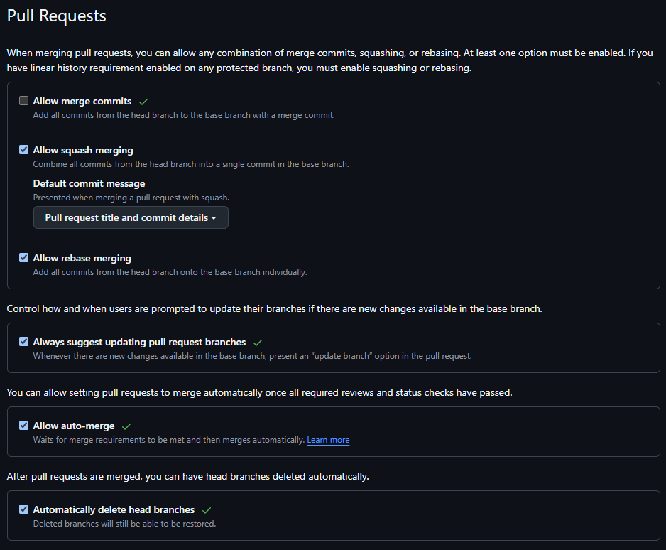
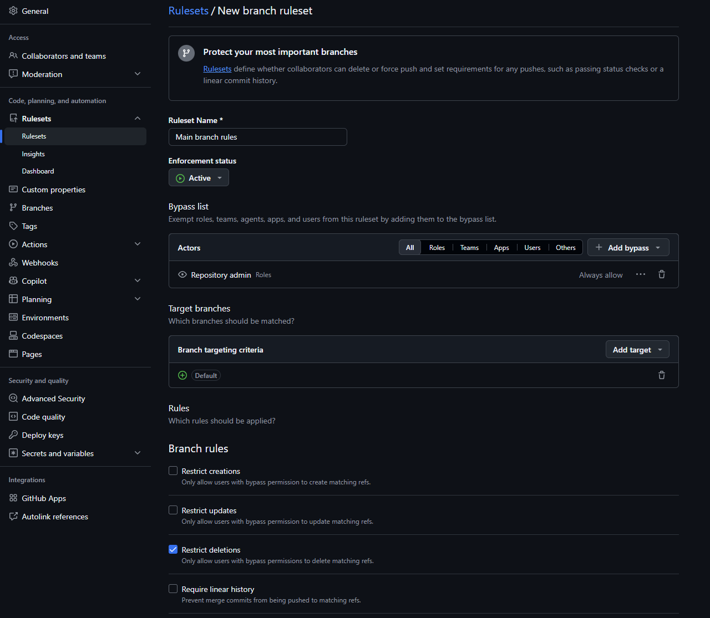
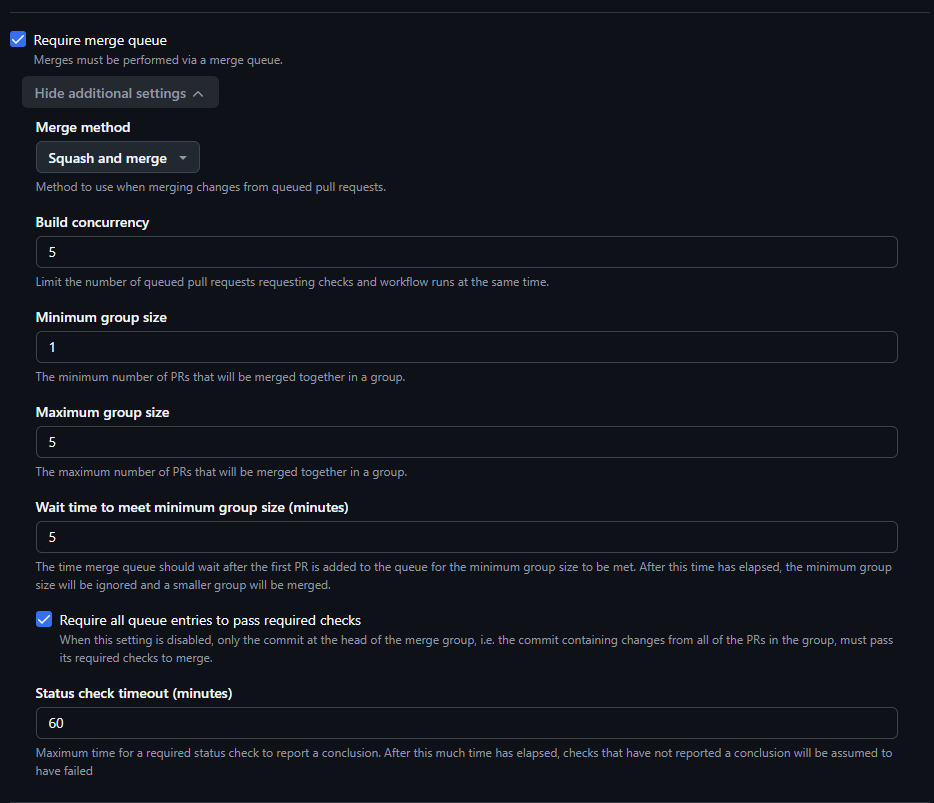
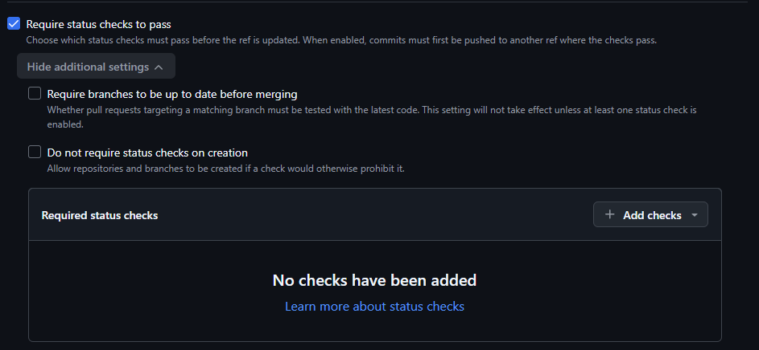

# Git/Github

## Common guidelines

When using Git, here are some common guidelines. For all of these, the fictive example will use a ticket identifier of `TICKET-123` where the work is _"a new button under form X"_

- **When opening up a new branch** and working on a ticket, use the ticket identifier as a prefix to the branch. For example, name your branch `TICKET-123_<some_text_separated_by_one_underscore>`. You can replace `<some some_text_separated_by_one_underscore>` with a few word description of the ticket, or omit it completely. Separate each word with one underscore `_`.
  - NOTE! If you've heard someone mention using two underscores `__` when naming your branches, this is only used when creating a special merge-branch during deployment stages in OVP. Documentation for that is found [here](https://github.com/Opetushallitus/dev-toolkit-private).
- **When committing code**, write your commit message in the format `<descriptive tag>: <message>`. A non-exhaustive list of descriptive tags include `feat` (i.e. feature), `fix`, `test`, `WIP` (i.e. work-in-progress), `docs` (i.e. documentation), `debug`, and `style`. Defaulting to use `feat` is fine. The purpose is to make it easier to recognize what the changes in the commit is about, especially during PR reviews
- **When opening up a new pull request (PR)**
  - Set the PR title to be of the form `<ticket identifier>:<descriptive title text>`. For example, `TICKET-123: Add a new button under form X`
  - For the description: if you would be the reviewer, what information/details would be good for you to have when reviewing the code? No need to write an essay, keep it concise! In addition to a concise description of the changes, here is a checklist of things that can be relevant to add:
    - How have the changes been tested/verified? Locally or in a different environment?
    - Have you added/modified tests
    - Have you updated the documentation if needed?
  - NOTE! For the description, generally we use a PR template, but not all repositories have that added to them yet. You can find the template in the `configs`-directory

## GitHub settings

Seeing as there are more than a 100 repositories in the _Opetushallitus_ organization, keeping the repository settings similar makes maintaining them much easier. Below are images of settings that you need to apply for the repository.

Setting in the **General** tab:

Settings in the **Rulesets** tab:

### GitHub Actions and merge queues

All project repositories should require a merge queue for their target branch due to our usage of Renovate and their suggestions for it in their [best practices guides](https://docs.renovatebot.com/upgrade-best-practices/#use-github-pull-request-merge-queues).

#### Repositories with CI

Use [github-workflow-template.yaml](../configs/github-workflow-template.yaml) as a starting point:

1. Add the repository's actual CI jobs. The template's empty `jobs` section must be filled before use.
2. Adjust the `push` branch to match the repository's default branch (most likely `master` or `main`), or remove `push` if CI should only run before merging.
3. Place the completed workflow in `.github/workflows/ci.yaml` in the target repository.
4. Configure the checks that should block merging as required status checks in GitHub settings. Add them under the **Require status checks to pass** in the **Rulesets tab** (image shown above)

Keep both `pull_request` and `merge_group` triggers in every workflow that supplies required checks. The first checks the PR; the second checks its changes together with the latest target branch and any PRs ahead of it in the queue. Required PR checks also apply to the merge queue, so missing results on `merge_group` can block merging. Ensure any job conditions allow required checks to report on both events.
